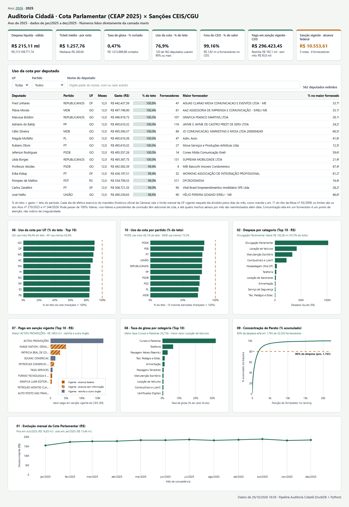

# Pipeline de Auditoria Cidadã e Compliance · CEAP (Câmara) × CEIS/CNEP (CGU)

[](https://github.com/Sandoque/auditoria_cidada/actions/workflows/ci.yml)

🔗 **Painel Executivo Online (GitHub Pages)**: **[Abrir `relatorio.html` no navegador](https://sandoque.github.io/auditoria_cidada/relatorio.html)** — ano mais recente; os anos anteriores ficam em `relatorio_AAAA.html`, com links no topo da página.

Pipeline completo de Engenharia de Dados construído do zero com **Spec-Driven Development**, **Python**, **DuckDB**, **SQL**, **Streamlit**, **Plotly** e **Pytest** para auditar os desembolsos da **Cota para Exercício da Atividade Parlamentar (CEAP, de 2025 até o ano corrente)** cruzados com o **Cadastro Nacional de Empresas Inidôneas e Suspensas (CEIS/CGU)**, o **Cadastro e o Histórico de Mandatos dos Deputados** e os **Limites Oficiais de Cota por UF (Atos da Mesa da Câmara)**.



<sub>Página de 2025 no GitHub Pages. O primeiro rascunho do layout, em grade de 12 colunas, está em [`design/rascunho.png`](design/rascunho.png).</sub>

---

## Achados

O que os dados de 2025 mostram, e o que só apareceu porque cada número foi conferido contra a fonte oficial em vez de aceito como saiu da consulta:

1. **"Pago a empresa sancionada" quase nunca quer dizer "pago a quem estava proibido de vender para a Câmara".** Em 2025, R$ 296.423,45 foram pagos a fornecedores com sanção vigente no CEIS. Lendo o alcance de cada sanção no próprio cadastro, só **R$ 10.553,61** (5 notas, 4 fornecedores) vêm de sanções que alcançam a esfera federal; R$ 192.079,60 são de sanções que valem só em outro órgão ou esfera, e R$ 93.790,24 não têm o alcance informado. Somar tudo como "risco" exagerava o problema quase 30 vezes.
2. **A tabela de limites da cota usada pelo projeto estava errada em 22 das 27 UFs.** A pista foi estatística: 30 deputados apareciam gastando mais do que a cota permite. Com a tabela oficial do Ato da Mesa n.º 270/2023, vários deputados de Goiás passaram a fechar o ano em **exatamente 100,00%** (R$ 495.610,32 = 12 × R$ 41.300,86) — a assinatura de quem gasta a cota até o último centavo, e a prova de que o limite agora é o que a Câmara aplica.
3. **A API da Câmara registra a volta de suplentes de forma inconsistente.** Reentradas aparecem como `"DIVERSO - … / Entrada - Reassunção"`, às vezes com situação `CONVOCADO`. Lendo só a situação, três suplentes ficavam com 43 a 101 dias de mandato num ano em que gastaram todos os meses — e com 300% a 675% de uso da cota. Com a regra corrigida, os 562 deputados de 2025 têm período oficial de mandato e o maior uso cai para 100,8%, coerente com os adicionais de cota de líderes e presidentes de comissão.
4. **Em reais, quase todo ranking só mede tamanho.** O PL lidera o gasto por partido (18,4%) porque tem 104 deputados; medido em % do teto, as 10 maiores bancadas ficam todas entre 73% e 83%. Na glosa, Locação de Veículos lidera em reais, mas a Câmara corta só 0,67% do valor; a maior taxa é de Cursos e Palestras (32,1%). No uso médio, a Câmara gastou **76,9% do teto** em 2025, e 120 dos 562 deputados usaram 90% ou mais.
5. **Em aberto: 2026 tem cara de ano eleitoral.** O gasto cai de R$ 23,5 mi em maio para R$ 12,9 mi em junho, um mês já fechado (passado o prazo de 90 dias para apresentar notas). A hipótese é a restrição à divulgação do mandato antes da eleição — divulgação é quase metade do gasto —, ainda não testada por categoria.

---

## 1. Fonte dos Dados e Licença Pública

Todos os conjuntos de dados são públicos, oficiais e abertos sob a **Lei de Acesso à Informação (Lei n.º 12.527/2011)** e a **Política de Dados Abertos do Poder Executivo e Legislativo Federal (Licença Creative Commons Attribution 4.0 — CC BY 4.0)**:

| Arquivo em `raw/` | Fonte Oficial | Link da Fonte | Registros |
| :--- | :--- | :--- | ---: |
| `despesas_ceap.csv.gz` | Câmara dos Deputados — Dados Abertos (CEAP, um arquivo por ano empilhado) | `https://www.camara.leg.br/cotas/Ano-AAAA.csv.zip` (2025 até o ano corrente) | 290.602 (171.059 de 2025) |
| `deputados.csv.gz` | Câmara dos Deputados — Cadastro de Parlamentares | `https://dadosabertos.camara.leg.br/arquivos/deputados/csv/deputados.csv` | 7.889 |
| `sancoes_ceis.csv.gz` | Controladoria-Geral da União (CGU) — Portal da Transparência (CEIS do dia) | `https://portaldatransparencia.gov.br/download-de-dados/ceis` | 23.759 |
| `sancoes_cnep.csv.gz` | Controladoria-Geral da União (CGU) — Portal da Transparência (CNEP) | `https://portaldatransparencia.gov.br/download-de-dados/cnep` | 1.853 |
| `cotas_uf.csv.gz` | API de Localidades do IBGE (cadastro das UFs) | `https://servicodados.ibge.gov.br/api/v1/localidades/estados` | 27 |
| `limites_cota_uf.csv.gz` | Atos da Mesa da Câmara n.º 270/2023 (vigente de 01/02/2023) e n.º 244/2026 (vigente de 20/02/2026), digitados e conferidos | [Ato 270/2023, Anexo I](https://www2.camara.leg.br/legin/int/atomes/2023/atodamesa-270-19-janeiro-2023-793708-anexo-cd-mesa.pdf) · [Cota Parlamentar — Câmara](https://www2.camara.leg.br/comunicacao/assessoria-de-imprensa/guia-para-jornalistas/cota-parlamentar) | 54 |
| `historico_deputados.csv.gz` | Câmara dos Deputados — API de Dados Abertos (histórico de mandato de cada deputado com despesa) | `https://dadosabertos.camara.leg.br/api/v2/deputados/{id}/historico` | 6.353 |
| **Total em `raw`** | | | **330.537** |

> Os sete arquivos `.csv.gz` estão versionados em `raw/` (~14 MB, retrato de 29/10/2026) para execução imediata e offline; os números de conferência das seções 2 a 4 são os do ano de 2025 desse retrato. Para baixar de novo direto dos portais governamentais, execute `uv run python scripts/baixar_dados_oficiais.py`. O GitHub Pages pode ser republicado com dados novos pelo workflow sob demanda (seção 5).

---

## 2. O Grão ("O que é uma linha de cada tabela?") e Mapa de Ligações

Antes de qualquer `SELECT` ou `JOIN`, o grão e as chaves de cada tabela em `refined` são:

| Tabela em `refined` | O que é uma linha (Grão) | Chave Primária (PK) | Chaves Estrangeiras (FK) | Linhas |
| :--- | :--- | :--- | :--- | ---: |
| `refined.despesas_ceap` | Um lançamento de despesa/reembolso na Cota Parlamentar | `(documento_id, cadastro_interno_id, subcota_id, parcela, numero_documento, valor_liquido, ano_competencia, mes_competencia)` | `deputado_id` → `deputados`<br>`uf` → `cotas_uf`<br>`documento_fornecedor` → `sancoes_ceis` | 171.059 |
| `refined.deputados` | Um deputado federal cadastrado na história da Câmara | `deputado_id` (extraído do final da `uri`) | `uf_nascimento` → `cotas_uf` | 7.889 |
| `refined.sancoes_ceis` | Uma sanção administrativa publicada no CEIS | `sancao_id` (`CÓDIGO DA SANÇÃO`) | `documento_sancionado` (não é único: 23.739 sanções para 16.934 CPF/CNPJs) | 23.739 |
| `refined.cotas_uf` | Uma Unidade da Federação brasileira | `uf` (`sigla_uf`) | — | 27 |

### Ligações e comportamento do JOIN
- **`despesas_ceap` → `deputados` (`deputado_id`, $N : 1$)**: Todos os 562 `deputado_id` presentes na CEAP 2025 encontram seu cadastro em `refined.deputados`. Porém, **937 lançamentos** são de **Lideranças Partidárias** (`LID.GOV-CD`, `LIDERANÇA DO PT`, etc.) e possuem `deputado_id IS NULL`. Usar `INNER JOIN` apaga os gastos de lideranças; para preservá-los, usa-se `LEFT JOIN`.
- **`despesas_ceap` → `cotas_uf` (`uf`, $N : 1$)**: Pelos mesmos 937 lançamentos de Lideranças Partidárias, `uf` é `NULL` nessas linhas.
- **`despesas_ceap` ↔ `sancoes_ceis` (`documento_fornecedor = documento_sancionado`, $N : M$)**: **Armadilha central de grão do projeto**. `documento_sancionado` não é PK de `sancoes_ceis` (um mesmo CNPJ possui múltiplas sanções). Juntar as duas tabelas diretamente multiplica as notas fiscais daquele fornecedor pelo número de sanções. Todo mart que cruza com o CEIS reduz primeiro `sancoes_ceis` ao grão de *1 linha por `documento_sancionado`* numa CTE.

---

## 3. Arquitetura em Três Camadas e Palavras com Definição Fechada

```text
raw/ (5 arquivos .csv.gz intocados)
  ↓  pipeline/ingestao.py (tudo entra como VARCHAR, 204.567 linhas)
raw.* (espelho fiel dos arquivos governamentais no auditoria.duckdb)
  ↓  pipeline/transformacao.py (tipos declarados, strptime/CAST sem TRY_CAST, 202.714 linhas)
refined.* (dado limpo e tipado no grão do evento, nulos preservados com motivo)
  ↓  sql/marts/01..12.sql + pipeline/marts.py (12 marts transacionais)
marts.* (tabelas agregadas no grão exato de cada pergunta de auditoria)
  ↓  painel.py -> app.py (Streamlit) e relatorio.py (relatorio.html)
Apresentação (zero cálculo na tela: apenas SELECT * FROM marts.<nome>)
```

### Quatro palavras com definição fechada no projeto inteiro

| Termo | Definição fechada | Em SQL |
| :--- | :--- | :--- |
| **Lançamento válido** | Despesa efetivamente desembolsada (`valor_liquido > 0`), excluindo os 33 estornos/compensações negativas de bilhetes aéreos cancelados (`171.026` de `171.059` linhas). | `WHERE valor_liquido > 0` |
| **Despesa líquida** | Soma de `valor_liquido` dos lançamentos válidos (`R$ 215.109.771,74`), já descontadas as glosas (`R$ 1.012.889,88` cortados pela Câmara). | `sum(valor_liquido)` |
| **Fornecedor** | O documento normalizado `documento_fornecedor` (apenas dígitos, `VARCHAR` para preservar zero à esquerda), **nunca** `nome_fornecedor` (uma mesma empresa como a Vivo aparece com mais de 10 grafias diferentes). | `documento_fornecedor` |
| **Mês** | O mês de competência oficial (`ano_competencia`, `mes_competencia`), preenchido em 100% da base (enquanto `data_emissao` é nula nas 7.841 faturas de `TELEFONIA`). | `make_date(ano_competencia, mes_competencia, 1)` |

---

## 4. Os 12 Marts em `sql/marts/` e Números de Conferência

| Arquivo SQL | Tabela em `marts` | Grão | Linhas | Número de Conferência |
| :--- | :--- | :--- | ---: | :--- |
| `01_gastos_mensais.sql` | `marts.gastos_mensais` | Um mês de competência | 12 | Total `R$ 215.109.771,74` · Pico out/2025: `R$ 18.827.804,70` |
| `02_gastos_por_categoria.sql` | `marts.gastos_por_categoria` | Uma categoria de despesa | 18 | Total `R$ 215.109.771,74` · 1.ª Divulgação: `R$ 102.059.898,64` (47,4%) |
| `03_conformidade_ceis.sql` | `marts.conformidade_ceis` | A operação inteira (1 linha) | 1 | `171.026` válidos · `2.976` no CEIS (`R$ 1.816.195,33`) · `50` em sanção vigente (`R$ 296.423,45`), dos quais só `5` (`R$ 10.553,61`) com alcance federal · `R$ 192.079,60` restrita a outro órgão · `R$ 93.790,24` sem informação |
| `04_ranking_deputados.sql` | `marts.ranking_deputados` | Um deputado federal ativo | 562 | Ranking com `rank() OVER` + dados civis e região IBGE · uso do teto por meses de exercício (`112` deputados com 90% ou mais) · concentração no maior fornecedor (`23` com 80% ou mais) |
| `05_recorrencia_fornecedores.sql` | `marts.recorrencia_fornecedores` | Uma faixa de qtd. de pagamentos | 7 | `22.250` fornecedores · `42,37%` pagamento único · `57,63%` recorrentes (2+) |
| `06_gasto_medio_por_uf.sql` | `marts.gasto_medio_por_uf` | Uma UF (grão muda 2x) | 27 | Uso do teto por deputado-mês: `DF` (`94,98%`) no topo e `PA` (`63,46%`) na base · maior média anual/deputado: `AC` (`R$ 532.679,03`) |
| `07_fornecedores_sancionados.sql` | `marts.fornecedores_sancionados` | Um CNPJ/CPF sancionado no CEIS com pagamento na CEAP | 19 | `14` com recebimento em vigência (`ACTON PROMOÇÕES`: `R$ 169.000,00`, sanção restrita a outro órgão; `IMAGE NATION`: `R$ 49.800,00`, sem informação de alcance) · coluna `alcance_sancao_vigente` (regra em `specs/marts.md`, seção 6) |
| `08_glosa_por_categoria.sql` | `marts.glosa_por_categoria` | Uma categoria de despesa | 18 | Total glosado `R$ 1.012.889,88` em `9.873` notas · Maior corte: Locação de veículos (`R$ 281.403,14`) |
| `09_fornecedores_pareto.sql` | `marts.fornecedores_pareto` | Um fornecedor com venda válida | 22.250 | `80%` de toda a despesa concentrados na posição `1.765` (`7,93%` dos fornecedores) |
| `10_gastos_por_partido.sql` | `marts.gastos_por_partido` | Um partido (ou `'LIDERANCAS'`) | 23 | Soma `R$ 215.109.771,74` (inclui os 937 lançamentos de lideranças sem partido individual) · 10 maiores bancadas entre `73,12%` (MDB) e `82,05%` (PSB) do teto |
| `11_kpis.sql` | `marts.kpis` | A operação inteira (1 linha) | 1 | Alimenta os 7 cartões executivos (`R$ 215,11 mi` · Ticket `R$ 1.257,76` · Mediana `R$ 240,04` · `76,32%` do teto usado) |
| `12_deputados_por_uf.sql` | `marts.deputados_por_uf` | Uma UF | 27 | `SP` com `78` deputados ativos, `RJ` com `53`, `MG` com `56` |

---

## 5. Como Rodar do Zero (Comandos)

Pré-requisito: ter o gerenciador [`uv`](https://docs.astral.sh/uv/) instalado.

```bash
# 1. Instalar/sincronizar o ambiente virtual a partir do uv.lock
uv sync

# 2. Rodar as três etapas do pipeline + verificação de qualidade de dados
uv run python -m pipeline.ingestao
uv run python -m pipeline.transformacao
uv run python -m pipeline.marts
uv run python -m pipeline.qualidade

# (Alternativa) Rodar tudo do zero + gerar relatorio.html em um único comando
uv run python executar.py

# 3. Explorar o banco em SQL pelo navegador (DuckDB UI em http://localhost:4213)
# Lembre-se de encerrar com Ctrl+C antes de rodar o pipeline de escrita!
uv run python ui.py

# 4. Abrir o dashboard interativo no Streamlit (http://localhost:8501)
uv run streamlit run app.py

# 5. Gerar o relatório estático: relatorio.html (ano mais recente) + relatorio_AAAA.html (anos anteriores)
uv run python relatorio.py

# 6. Rodar a suíte de testes unitários com cobertura (>= 60%, atual: 94%) e linter
uv run pytest --cov
uv run ruff check .
```

### Atualização sob demanda (GitHub Actions)

O workflow [`atualizar_dados.yml`](.github/workflows/atualizar_dados.yml) roda só quando disparado (**Actions → Atualização dos dados e do painel → Run workflow**); o agendamento semanal está desligado porque o projeto é uma demonstração, e religá-lo é uma linha no arquivo. Ele baixa os dados oficiais, roda os testes, reconstrói o pipeline do zero com as regras de qualidade e, só se tudo passar, faz commit dos `relatorio*.html` na `main` — o que republica o GitHub Pages. Se qualquer passo falhar (portal fora do ar, regra de qualidade quebrada), a página anterior continua no ar. Os arquivos de `raw/` não entram nesse commit para o repositório não crescer a cada atualização. Regras completas em [`specs/multianual.md`](specs/multianual.md).

---

## 6. Onde a IA Errou ou Assumiu o que Não Pedimos — e Como Descobrimos Contando Linhas

Durante o desenvolvimento orientado a specs, aplicamos a regra de ouro do curso (**contar antes → rodar → contar depois**) e interceptamos quatro erros clássicos que passariam silenciosamente sem lançar exceção:

1. **O sumiço silencioso de 31 faturas de Telefonia na Etapa 2 (`171.059 → 171.028 linhas`)**:
   - *O que aconteceu*: Na primeira versão do `SELECT DISTINCT` de `refined.despesas_ceap`, a coluna `txtNumero` (`numero_documento`) não havia sido incluída no mapa de colunas, assumindo-se que `ideDocumento` (`documento_id`) identificava cada fatura. Ao rodar a transformação, a saída mostrou `171.059 → 171.028 linhas (31 duplicatas)` e os nulos de `data_emissao` caíram de `7.841` para `7.810`.
   - *Como descobrimos*: Em vez de aceitar que "deviam ser 31 duplicatas do arquivo original", rodamos um `SELECT DISTINCT * FROM raw.despesas_ceap` (que deu `171.059`, zero duplicatas) e fizemos um agrupamento para inspecionar as 31 linhas que haviam colapsado. Descobrimos que nas despesas internas de `TELEFONIA` (`CELULAR FUNCIONAL`), `ideDocumento` vem zerado (`'0'`) e o número real da conta telefônica fica em `txtNumero`. Quando um mesmo deputado pagava duas linhas funcionais de mesmo valor mensal (`R$ 209,34`) no mesmo mês, o `SELECT DISTINCT` sem `txtNumero` fundia as duas faturas em uma só, apagando `R$ 5.839,51`! Incluir `txtNumero AS numero_documento` na spec restaurou `171.059 → 171.059 linhas`.
2. **A multiplicação de dinheiro no JOIN direto com o CEIS na Etapa 3 (`R$ 1.816.195,33 → R$ 1.864.222,31`)**:
   - *O que aconteceu*: Ao cruzar `refined.despesas_ceap` com `refined.sancoes_ceis` por `documento_fornecedor = documento_sancionado`, um `JOIN` direto retornou `3.010` lançamentos e `R$ 1.864.222,31`.
   - *Como descobrimos*: Contando os lançamentos antes e depois do `JOIN`, vimos que existiam apenas `2.976` notas fiscais de fornecedores presentes no CEIS. As `34` linhas extras (e os `R$ 48.026,98` inventados) nasceram porque `refined.sancoes_ceis` tem grão de *sanção* (`23.739` sanções para `16.934` documentos), e fornecedores com 2 ou mais sanções tiveram todas as suas notas fiscais multiplicadas. A solução foi obrigar o uso da CTE `ceis_por_fornecedor` (1 linha por `documento_sancionado`) antes do `JOIN` nos marts `03`, `07` e `11`, além de um teste unitário (`test_marts_reais_excluem_negativo_e_nao_multiplicam_sancao_dupla`) e uma regra em `pipeline/qualidade.py`.
3. **A armadilha do `'NA'` em `sgUF` e dos `7.841` nulos em `data_emissao` na Etapa 2**:
   - *O que aconteceu*: Uma consulta ingênua `SELECT count(*) - count(sgUF) FROM raw.despesas_ceap` devolveu `0` nulos, sugerindo que toda despesa tinha um estado válido. Além disso, agrupar vendas/gastos mensais usando `date_trunc('month', data_emissao)` fazia desaparecerem `7.841` registros.
   - *Como descobrimos*: Ao cruzar os `937` registros onde `ideCadastro IS NULL` (gastos de Lideranças Partidárias), vimos que a Câmara preenche `sgUF` com o texto literal `'NA'` (que o `pandas` sem `keep_default_na=False` engoliria ou que o SQL contaria como uma 28.ª UF do Brasil!). Documentamos `NULLIF(sgUF, 'NA') AS uf` na spec de `refined`. E ao investigar `WHERE datEmissao IS NULL`, provamos que 100% dos `7.841` casos são faturas de `TELEFONIA`, motivo pelo qual a definição fechada de **Mês** usa `make_date(ano_competencia, mes_competencia, 1)` e nunca descarta linhas sem `data_emissao`.
4. **A tabela de limites da cota defasada em 22 das 27 UFs (`30` deputados acima de 100% do teto)**:
   - *O que aconteceu*: O primeiro cálculo de uso do teto (gasto ÷ limite mensal × meses de exercício) mostrou `30` deputados gastando mais do que a cota permite — até `110,4%` — embora o saldo da CEAP só acumule dentro do próprio ano.
   - *Como descobrimos*: Em vez de aceitar "alguns deputados estouram a cota", fomos à fonte do limite. A tabela digitada em `scripts/baixar_dados_oficiais.py` batia com o Anexo I do **Ato da Mesa n.º 270/2023** (vigente de fev/2023 até o reajuste do Ato n.º 244/2026, ou seja, todo o ano de 2025) em só `5` UFs (AC, AP, DF, RO e RR); as outras `22` estavam com valores anteriores (SP: `R$ 41.150,25` em vez de `R$ 42.837,33`). Com a tabela oficial, restaram `4` casos acima de 100% (três entre `100,0%` e `100,8%`), e vários deputados de GO passaram a fechar o ano em **exatamente** `100,00%` (`R$ 495.610,32` = 12 × `R$ 41.300,86`) — a prova de que o limite agora é o mesmo que a Câmara aplica. Os casos marginais acima de 100% são coerentes com o art. 2.º, § 3.º, do Ato n.º 43/2009, que reembolsa até quatro trechos aéreos por mês **além** da cota.
